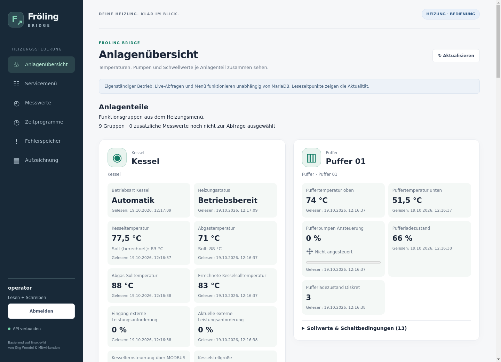
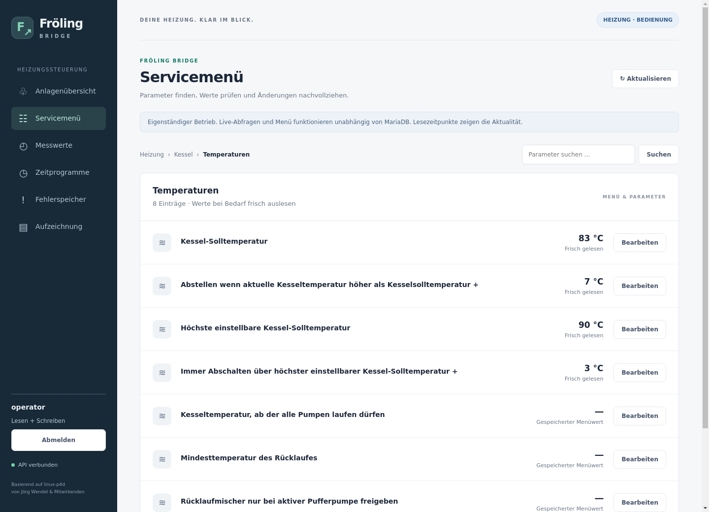
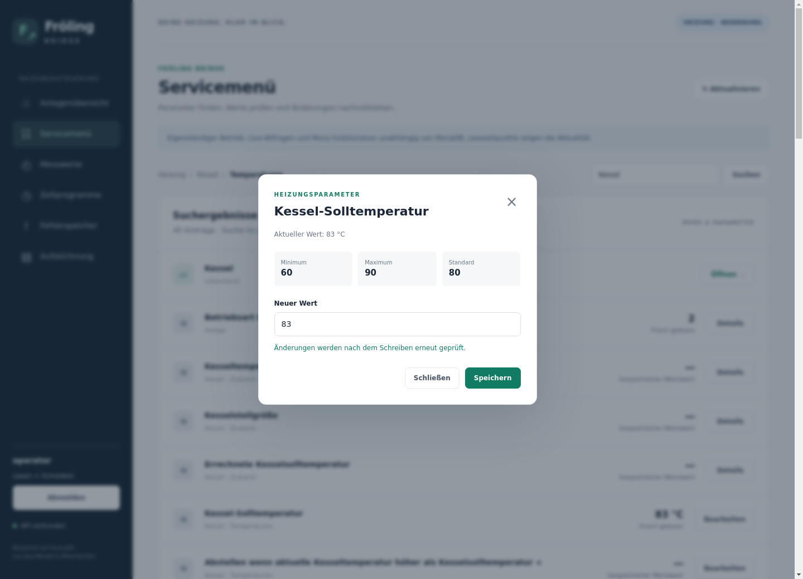
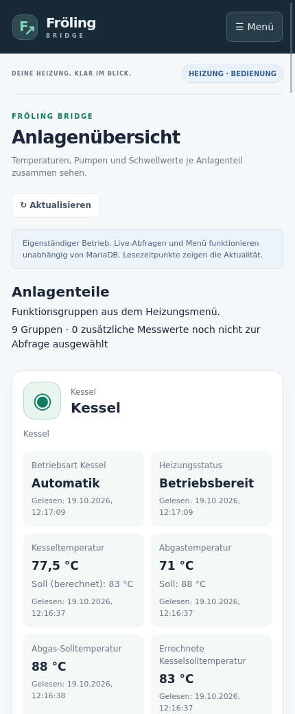
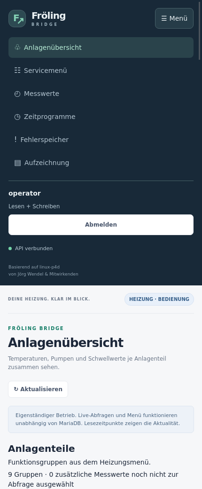

# Fröling Bridge

Heizung überwachen und bedienen – auf einem Raspberry Pi oder einem anderen Linux-Rechner, mit Weboberfläche und API. Für Fröling-Steuerungen der **Lambdatronic-S3200-Familie**. Aktuelle Version: **0.7.2**.

Der Rechner wird über einen seriellen USB-Adapter mit der Heizung verbunden. Nach der Installation öffnest du im Heimnetz die IP-Adresse des Rechners und meldest dich an. **Eine Domain, ein Reverse Proxy und MariaDB sind dafür nicht nötig.**

## Grundlage und Dank

Dieses Projekt baut auf der Arbeit von Jörg Wendel (horchi) und dem Open-Source-Projekt [linux-p4d](https://github.com/horchi/linux-p4d) auf.

p4d erschließt die Kommunikation mit der Heizungssteuerung und stellt umfangreiche Funktionen zur Überwachung und Bedienung bereit. Der veröffentlichte Quellcode ist eine wesentliche Grundlage für unsere Untersuchung des Protokolls und der Datenbankstruktur. Vielen Dank an den Autor und alle Mitwirkenden dafür.

Als Ausgangspunkt der Bestandsaufnahme verwenden wir den [Fork von vgarcia007](https://github.com/vgarcia007/linux-p4d). Der konkret untersuchte Stand ist in der Dokumentation festgehalten.

Fröling Bridge ist ein eigenständiges Projekt mit dem Schwerpunkt auf Python, API-Zugriff und Parameterbedienung. Es wird unabhängig vom p4d-Projekt und vom Heizungshersteller entwickelt.

## 1. Installieren

Du brauchst Raspberry Pi OS, Debian oder Ubuntu mit systemd, Python ab 3.9, Internetzugang für die Installation und den angeschlossenen Heizungsadapter. Die Befehle im Terminal **auf dem Heizungsrechner** ausführen.

```sh
sudo apt-get update
sudo apt-get install -y git python3 python3-venv

git clone https://github.com/vgarcia007/froeling-bridge.git
cd froeling-bridge
sudo bash deploy/install-standalone.sh
```

Der Installer erledigt Python-Umgebung, Dienstbenutzer, Adapterrechte, Konfiguration, Login und Autostart. Er wählt einen eindeutig erkannten Adapter automatisch; sonst fragt er nach dessen Gerätepfad, beispielsweise `/dev/ttyUSB0`.

Bei **„MariaDB für optionale Historie einrichten?“** für den einfachen Start **Enter drücken**. Live-Werte und Heizungsmenü funktionieren ohne MariaDB. Für gespeicherte Messreihen kannst du sie später einrichten: [Datenbank konfigurieren](docs/standalone.md#konfiguration-und-speicherorte).

**Falls bereits p4d auf diesem Rechner läuft:** Statt des letzten Befehls diesen verwenden:

```sh
sudo bash deploy/install-standalone.sh --take-over-p4d
```

Die Bridge stoppt p4d vor dem Zugriff auf den Adapter. Beide dürfen nicht gleichzeitig darauf zugreifen. Eigene Cronjobs, die p4d wieder starten, vorher deaktivieren. [Details zur Übernahme](docs/standalone.md#bestehende-p4d-installation-übernehmen).

Der erste Start liest Sensoren, Menü und Zeitprogramme aus der Heizung und kann einige Minuten dauern. Der Installer wartet auf betriebsbereite Erfassung und zeigt anschließend die Browseradresse an.

## 2. Im Browser öffnen

Auf Handy oder PC **im selben Heimnetz** öffnen:

```text
http://IP-DES-HEIZUNGSRECHNERS:8000
```

Beispiel: `http://192.168.178.50:8000`. Die IP findest du in deinem Router oder auf dem Heizungsrechner mit:

```sh
hostname -I
```

**Es erscheint die Login-Seite.** Der direkte HTTP-Zugang ist für das vertrauenswürdige Heimnetz gedacht und unverschlüsselt. Für einen Zugang aus dem Internet gibt es eine separate [HTTPS-Anleitung](docs/authentication.md#optional-https-und-reverse-proxy).

## 3. Zum ersten Mal anmelden

Der Installer legt den Benutzer **`operator`** mit Lese- und Schreibrechten an. Sein zufällig erzeugtes Erstpasswort auf dem Heizungsrechner anzeigen:

```sh
sudo cat /var/lib/froeling-bridge-installer/initial-login.json
```

In der Ausgabe steht das Passwort hinter `"password"`. Im Browser `operator` und dieses Passwort eingeben.

## 4. Eigene Benutzer anlegen

Benutzer und Passwörter verwaltest du **auf dem Heizungsrechner im Terminal**, in einem beliebigen Verzeichnis. Es gibt dafür keinen Webdialog.

Lege einen persönlichen Benutzer an; `max` durch deinen gewünschten Namen ersetzen:

```sh
sudo froeling-bridge-users add max --role write
```

Das gewünschte Passwort zweimal eingeben, mindestens **15 Zeichen**. Die Eingabe bleibt unsichtbar. Anschließend kannst du dich im Browser mit diesem Benutzer anmelden.

Für jemanden, der ausschließlich lesen darf, stattdessen `--role read` verwenden. Mit `write` darf der Benutzer auch Heizungsparameter ändern; `read` erlaubt ausschließlich Lesen.

Das Passwort des ursprünglichen Kontos ändern:

```sh
sudo froeling-bridge-users password operator
```

Nach dem Ändern ist das ursprüngliche Passwort in `initial-login.json` ungültig; die Übergabedatei kannst du dann entfernen. [Weitere Benutzerbefehle und API-Schlüssel](docs/authentication.md#benutzer-auf-der-konsole-verwalten).

## 5. Heizung ansehen

- **Anlagenübersicht:** Kessel, Puffer, Boiler, Heizkreise, Temperaturen und Pumpenansteuerungen.
- **Servicemenü:** Menü der Heizungssteuerung mit den Originalbezeichnungen.
- **Messwerte:** Sensoren ansehen und auswählen, was abgefragt und gegebenenfalls aufgezeichnet wird.
- **Zeitprogramme und Fehlerspeicher:** Zeiten und Heizungsmeldungen ansehen.

Der Dienst startet nach einem Rechnerneustart automatisch und erfasst die Heizungsdaten laufend. Benutzer mit Schreibrechten können bearbeitbare Heizungsparameter direkt im Servicemenü ändern. Eine zusätzliche Freischaltung ist nicht nötig.

## Screenshots

Aufnahmen aus einer laufenden Heizungsinstallation vom 19.10.2026.

**Anlagenübersicht mit Temperaturen, Sollwerten und Pumpenansteuerungen:**



<details>
<summary>Servicemenü, Parameterdialog und mobile Bedienung ansehen</summary>

**Servicemenü mit den Bezeichnungen aus der Heizungssteuerung:**



**Parameter bearbeiten, mit aktuellem Wert und zulässigen Grenzen:**



**Auf dem Handy: Anlagenübersicht und aufklappbares Menü.** Die Bilder lassen sich für die volle Größe öffnen.

<a href="docs/images/anlage-mobil.png"></a>
<a href="docs/images/navigation-mobil.png"></a>

</details>

## Wenn etwas nicht funktioniert

Auf dem Heizungsrechner:

```sh
sudo froeling-bridge-control status
journalctl -u froeling-bridge.service -n 60
```

| Problem | Prüfen |
| --- | --- |
| Browser erreicht die Login-Seite nicht | Richtige Rechner-IP, `http://` und Port `8000`, gleiches Heimnetz, laufender Dienst. |
| Login funktioniert nicht | Benutzername und Passwort prüfen; der Serverbetreiber kann das Passwort per Konsole neu setzen. |
| Menü oder Werte fehlen | Startfortschritt im Dienststatus, Adapterverbindung und exklusiven Zugriff prüfen. |

## Weiterführende Anleitungen

- [Betrieb, Datenbankkonfiguration, Speicherung und Sicherungen](docs/standalone.md)
- [Benutzer, API-Schlüssel und optionaler HTTPS-/Reverse-Proxy-Zugang](docs/authentication.md)
- [API Schritt für Schritt: Heizungsstatus und alle Sensoren mit curl](docs/api-einstieg.md)
- [Anlagenübersicht im Detail](docs/plant-overview.md)
- [Entwicklung, Demo und ältere Betriebsarten](docs/service.md)
- [Technische Dokumentation und p4d-Bestandsanalyse](docs/README.md)

## Lizenz

Fröling Bridge steht unter der [GNU General Public License Version 2 (GPLv2)](LICENSE). Du darfst die Software nutzen, verändern, weitergeben und verkaufen – auch kommerziell. Bei Weitergabe gelten die GPL-Bedingungen, einschließlich der Bereitstellung des zugehörigen Quellcodes.

Herkunft und Copyright-Hinweise: [NOTICE.md](NOTICE.md).
