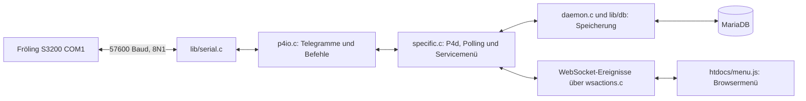

# p4d: Bestandsaufnahme für einen Python-Nachbau

Stand der Untersuchung: 16.10.2026. Ziel ist ein einfacher installierbarer Heizungsdienst mit API und modernem Servicemenü, der die vorhandene p4d-Datenbank weiterführen kann. Die Bestandsaufnahme ist inzwischen durch einen [Offline-Python-Kern mit Simulator](python-core.md) ergänzt. Ein Live-Heizungsdienst und ein API-Framework sind weiterhin nicht implementiert.

## Referenz und Aussagekraft

| Merkmal | Untersuchte Referenz |
| --- | --- |
| Repository | https://github.com/vgarcia007/linux-p4d |
| Branch | `master` |
| Commit | `4d1176c4a9081893e4c2cc27a535bb2bc4737d0a` |
| Commitdatum | 08.12.2025, 09:29:07 +0100 |
| Commitbeschreibung | Fixed widget scaling on 'Skala Min' option (Thx to HautdenLukas) |
| Lokaler Checkout | [`../reference/linux-p4d/`](../reference/linux-p4d/) |
| Vergleich | `git ls-remote https://github.com/horchi/linux-p4d.git HEAD refs/heads/master` lieferte am Untersuchungstag ebenfalls diesen Commit. Damit stimmen die beiden geprüften Branchspitzen einschließlich Historie überein; es gibt dort keinen Fork-spezifischen Protokoll-, Menü- oder Schema-Diff. Andere Branches sind damit nicht bewertet. |
| Original-Lizenz | [`GPLv2`](../reference/linux-p4d/LICENSE); Copyright-Hinweise im Referenzcode bleiben erhalten. |

Der installierte Quellstand und die Versionskennung der Dienstpfad-Binärdatei wurden inzwischen lesend als p4d 0.10.2 eingegrenzt: [Live-Server-Abgleich](live-server.md). Heizungsmodell und Firmware sind noch unbekannt. Die ursprüngliche Quellcodeanalyse erfolgte offline; anschließend wurde das reale Datenbankschema mit ausdrücklicher Nur-Lesen-Erlaubnis untersucht: [Live-Abgleich](live-database.md). Die Heizung wurde nicht angesprochen. Die Dokumentation beschreibt **belegtes Verhalten des Referenzcodes**, keine vom Hersteller bestätigte Protokollspezifikation.

## Lesereihenfolge

Für Installation, Demo und Python-Schnittstellen direkt zur [Anleitung des Offline-Kerns](python-core.md).

1. [Heizungsprotokoll](protocol.md): Transport, Telegramme, Befehle, Lesen und Fehlerfälle.
2. [Parametermenü und Schreiben](parameter-menu.md): kompletter Bedien- und Schreibpfad, einschließlich Zeitprogrammen.
3. [Datenbankkompatibilität](database-compatibility.md): Tabellen, Identitäten, Werte und Zeitsemantik.
4. [Live-Abgleich](live-database.md): bereinigte Strukturunterschiede zur laufenden Datenbank.
5. [Live-Server-Abgleich](live-server.md): installierte Version, Quellvergleich und vorhandene Empfangstelegramme.
6. [Befunde und nächste Schritte](findings-and-next-steps.md): priorisierte offene Punkte und nächste gemeinsame Entscheidungen.

Quellverweise zeigen auf den unveränderlichen Commit. **Belegt** bedeutet im Code nachvollzogen. **Offen** bedeutet ohne weitere Untersuchung oder echte Mitschnitte nicht geklärt. **Empfehlung** bezeichnet einen Vorschlag für den Nachbau, keine bereits beschlossene Architektur.

## Architektur des Bestands



Die `.c`-Dateien werden als C++ gebaut. `main.c` startet die Klasse `P4d`; `Daemon` enthält die allgemeine Infrastruktur, `P4d` die Heizungsfunktionen. `FroelingService` definiert Befehle und Datenstrukturen, `P4Request` serialisiert und liest sie. Das Menü ist teilweise aus der Heizung ermittelt, teilweise durch p4d-Heuristiken ergänzt. Quellen: [Make.config:51](https://github.com/vgarcia007/linux-p4d/blob/4d1176c4a9081893e4c2cc27a535bb2bc4737d0a/Make.config#L51) [main.c:131](https://github.com/vgarcia007/linux-p4d/blob/4d1176c4a9081893e4c2cc27a535bb2bc4737d0a/main.c#L131) [specific.c:118](https://github.com/vgarcia007/linux-p4d/blob/4d1176c4a9081893e4c2cc27a535bb2bc4737d0a/specific.c#L118) [service.h:20](https://github.com/vgarcia007/linux-p4d/blob/4d1176c4a9081893e4c2cc27a535bb2bc4737d0a/service.h#L20) [p4io.h:27](https://github.com/vgarcia007/linux-p4d/blob/4d1176c4a9081893e4c2cc27a535bb2bc4737d0a/p4io.h#L27).

Für den Nachbau sind drei Grenzen wichtig: serielle Kommunikation unabhängig vom HTTP-Zugriff; fachliche Parameterwerte unabhängig von alten Anzeigezeichenketten; Datenbankkompatibilität unabhängig von allen übrigen p4d-Funktionen. Das sind aus der Analyse abgeleitete Empfehlungen, noch keine Implementierungsentscheidung.

## Reproduzierbare Prüfung

```bash
cd froeling-bridge
python3 docs/tools/verify_protocol_examples.py
```

Benötigt werden Python 3, Git und ein C++17-Compiler (`c++`). Das Prüfwerkzeug extrahiert die Originalfunktionen `prepareRequest`, `readByte`, beide `readWord`-Varianten, `readHeader` sowie `crc` in einen temporären C++-Prüfstand. Nur Transport und umgebende Typen werden durch Speicher-Stubs ersetzt. Es öffnet weder TTY noch Datenbank und baut/installiert nicht den Daemon.

Ergebnis: acht [synthetische Telegrammvektoren](protocol-vectors.json) stimmen mit Encoder und Decoder überein; alle 65.536 16-Bit-Muster werden vorzeichenbehaftet und vorzeichenlos geprüft. Ungültige und abgeschnittene Escape-Folgen werden abgelehnt. Die Beispiele belegen die Bytecodierung, **nicht** die Antwortsemantik einer realen Heizung oder den kompletten Schreibablauf. Die extrahierten Originalfunktionen unterliegen der Lizenz des Referenzprojekts.
