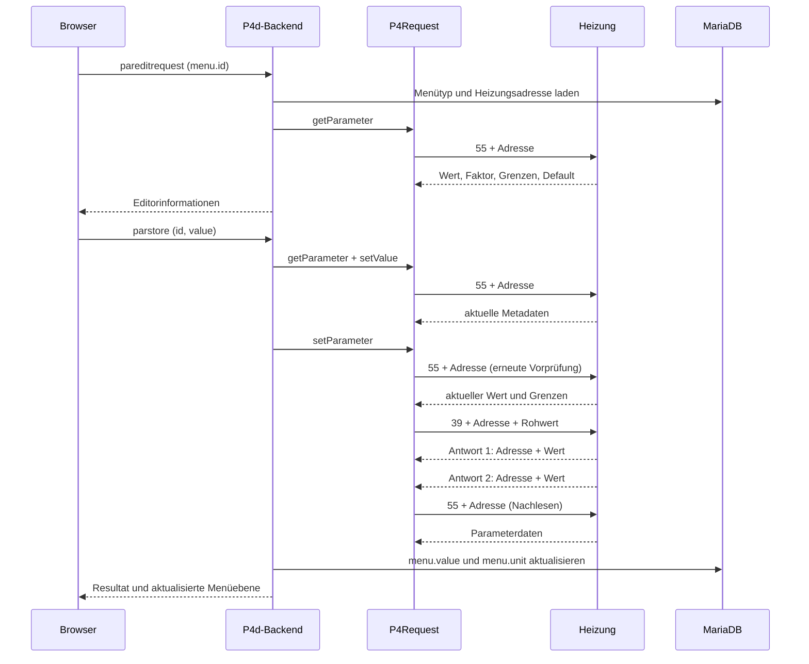

# Servicemenü und Zurückschreiben

Bezug: [untersuchter Referenzstand](README.md#referenz-und-aussagekraft). Die beschriebenen Abläufe sind aus dem Quellcode rekonstruiert; die tatsächliche Heizung wurde nicht angesprochen.

## Wie das Menü entsteht

`initMenu` prüft die Verbindung, leert die Tabelle `menu` per `TRUNCATE` und ruft `getFirstMenuItem` / `getNextMenuItem` (`37` / `38`) bis zum Listenende auf. Gespeichert werden Typ, Adresse, Parent, Child, Titel sowie zwei unbekannte Felder. Parameterwerte werden optional nachgeladen, ansonsten beim späteren Öffnen einer Menüebene. Quellen: [specific.c:894](https://github.com/vgarcia007/linux-p4d/blob/4d1176c4a9081893e4c2cc27a535bb2bc4737d0a/specific.c#L894) [p4io.c:1157](https://github.com/vgarcia007/linux-p4d/blob/4d1176c4a9081893e4c2cc27a535bb2bc4737d0a/p4io.c#L1157) [specific.c:970](https://github.com/vgarcia007/linux-p4d/blob/4d1176c4a9081893e4c2cc27a535bb2bc4737d0a/specific.c#L970).

`menu.id` ist eine lokale Auto-Increment-ID. Sie ist weder Heizungsadresse noch stabiler Menüschlüssel; eine Neuinitialisierung kann sie verändern. `parent` und `child` stammen aus dem Heizungsmenü. Für Ebene `n` liest p4d alle Zeilen mit `parent=n`; der Eintrag mit `child=n` liefert Titel und übergeordnetes Menü. Einstieg ist Ebene 1. Quelle: [specific.c:1977](https://github.com/vgarcia007/linux-p4d/blob/4d1176c4a9081893e4c2cc27a535bb2bc4737d0a/specific.c#L1977).

**Belegt:** Das Menü ist nicht vollständig generisch: p4d filtert leere Titel, Buswerte/Reset und die Sonderadressen 9997–9999. Blätter ohne Wert werden verborgen. Vier spezielle „Zeiten“-Gruppen werden durch synthetische Tages-/Intervallzeilen ersetzt. Die Menüsuchfunktion `performMenuBySearch` ist ein leerer Stub. Quellen: [specific.c:1977](https://github.com/vgarcia007/linux-p4d/blob/4d1176c4a9081893e4c2cc27a535bb2bc4737d0a/specific.c#L1977) [specific.c:1972](https://github.com/vgarcia007/linux-p4d/blob/4d1176c4a9081893e4c2cc27a535bb2bc4737d0a/specific.c#L1972).

**Empfehlung:** Im Nachbau die Originalstruktur und unbekannte Typen zunächst erhalten. Anzeige-Filter und firmwareabhängige Zuordnungen separat kenntlich machen; lokale Datenbank-ID, Menüpfad und Heizungsadresse nicht verwechseln.

## Parametertypen und Darstellungen

| Typ | Bedeutung laut Bestand | Lesen / Anzeige | Bearbeitbar im bestehenden Menü |
| --- | --- | --- | --- |
| `03`, `46` | Messwert | `30`, Metadaten aus `valuefacts`, skaliert | nein |
| `07` | numerischer Parameter | `55`, Nachkommastellen und Faktor | ja, Zahlenfeld |
| `08` | boolescher Parameter | `55`, Anzeige `ja` / `nein` | ja, Checkbox |
| `0A` | Zeitparameter | `55`, Rohwert als Minuten → `HH:MM` | ja, Zeitwähler |
| `32`, `39`, `40` | weitere numerische Parameter | `55`, Umrechnung wie `07` | ja, im Browser Textfeld |
| `0B` | Wochentagsparameter | deklariert, nicht als editierbar markiert | nein; Bedeutung nicht vollständig geklärt |
| `11`, `12`, `13` | digitaler Ausgang, analoger Ausgang, digitaler Eingang | `44`, `45`, `46`, Modus/Zustand | nein im hier untersuchten Parametermenü |
| `16` | Firmware | Status-/Versionsabfrage | nein |
| Gruppentypen | Navigation | `isGroup`, Parent/Child | Untermenüs |

Typdefinitionen und Gruppenliste: [service.h:143](https://github.com/vgarcia007/linux-p4d/blob/4d1176c4a9081893e4c2cc27a535bb2bc4737d0a/service.h#L143) [service.h:216](https://github.com/vgarcia007/linux-p4d/blob/4d1176c4a9081893e4c2cc27a535bb2bc4737d0a/service.h#L216). Die tatsächlich editierbaren Typen definiert [specific.c:1977](https://github.com/vgarcia007/linux-p4d/blob/4d1176c4a9081893e4c2cc27a535bb2bc4737d0a/specific.c#L1977), ihre Konvertierung [service.h:333](https://github.com/vgarcia007/linux-p4d/blob/4d1176c4a9081893e4c2cc27a535bb2bc4737d0a/service.h#L333), die Darstellung [htdocs/menu.js:76](https://github.com/vgarcia007/linux-p4d/blob/4d1176c4a9081893e4c2cc27a535bb2bc4737d0a/htdocs/menu.js#L76). `39` als **Menütyp** und `39` als **Befehl** sind unterschiedliche Namensräume.

Für Zahlen setzt `ConfigParameter::setValue` den Rohwert auf `Eingabe * Faktor`; der signed-16-Bit-Speicher bewirkt eine Ganzzahlkonvertierung. `digits` steuert Formatierung und numerische Eingabe, ist aber kein Ersatz für den Faktor. Die Browseroberfläche ersetzt bei Typ `07` den Dezimalpunkt vor dem Senden durch ein Komma. Das Backend verwendet `strtod` und die Prozess-Locale. Der Validator `isFloat` akzeptiert ein Komma, aber keinen Dezimalpunkt; `isNum` und `isFloat` akzeptieren außerdem leere bzw. nur aus einem Minus bestehende Zeichenketten. `strtod` muss anschließend dieselbe Locale erwarten. Die laufende Locale ist noch nicht bekannt. Quellen: [service.h:333](https://github.com/vgarcia007/linux-p4d/blob/4d1176c4a9081893e4c2cc27a535bb2bc4737d0a/service.h#L333) [htdocs/menu.js:76](https://github.com/vgarcia007/linux-p4d/blob/4d1176c4a9081893e4c2cc27a535bb2bc4737d0a/htdocs/menu.js#L76) [daemon.c:571](https://github.com/vgarcia007/linux-p4d/blob/4d1176c4a9081893e4c2cc27a535bb2bc4737d0a/daemon.c#L571) [lib/common.c:834](https://github.com/vgarcia007/linux-p4d/blob/4d1176c4a9081893e4c2cc27a535bb2bc4737d0a/lib/common.c#L834) [lib/common.c:855](https://github.com/vgarcia007/linux-p4d/blob/4d1176c4a9081893e4c2cc27a535bb2bc4737d0a/lib/common.c#L855).

**Empfehlung:** Eine künftige JSON-API transportiert Zahlen typisiert und localeunabhängig; Anzeigeformate wie `ja`, `65,0` und `nn:nn` gehören an den UI-/Kompatibilitätsrand. Konkrete Endpunkte und Datentypen werden erst im Implementierungsplan festgelegt.

## Bestehende Schnittstelle vom Browser zum Backend

Das Menü verwendet WebSocket-Ereignisse mit dem Format `{ "event": "…", "object": { … } }`.

| Ereignis | Eingabe | Wirkung |
| --- | --- | --- |
| `menu` | `parent` (Default 1), optional `search` | Ebene laden; Werte durch `updateParameter` aktualisieren; Ergebnis mit Titel, Rücksprung und `items` |
| `pareditrequest` | `id`, `parent`; bei Zeitintervallen zusätzlich `address`, `range` | aktuelle Parameterdaten oder gespeicherte Zeitbereichsdaten für den Editor liefern |
| `parstore` | `id`, `value`; bei Zeitintervallen `address`, `range`, `parent` | Änderung schreiben, Antwort senden, Menü erneut laden |

Bei normalen Parametern bestimmt das Backend Adresse und Typ aus der `menu`-Zeile anhand der ID. Das mitgesendete `address` ist hier nicht maßgeblich. `id=0` schaltet auf den Sonderpfad für Zeitintervalle um. Quellen: [htdocs/menu.js:190](https://github.com/vgarcia007/linux-p4d/blob/4d1176c4a9081893e4c2cc27a535bb2bc4737d0a/htdocs/menu.js#L190) [htdocs/menu.js:202](https://github.com/vgarcia007/linux-p4d/blob/4d1176c4a9081893e4c2cc27a535bb2bc4737d0a/htdocs/menu.js#L202) [htdocs/menu.js:178](https://github.com/vgarcia007/linux-p4d/blob/4d1176c4a9081893e4c2cc27a535bb2bc4737d0a/htdocs/menu.js#L178) [specific.c:1426](https://github.com/vgarcia007/linux-p4d/blob/4d1176c4a9081893e4c2cc27a535bb2bc4737d0a/specific.c#L1426) [specific.c:1693](https://github.com/vgarcia007/linux-p4d/blob/4d1176c4a9081893e4c2cc27a535bb2bc4737d0a/specific.c#L1693) [specific.c:1798](https://github.com/vgarcia007/linux-p4d/blob/4d1176c4a9081893e4c2cc27a535bb2bc4737d0a/specific.c#L1798).

Menülesen benötigt das Rechtebit `urView=0x01`; Editordaten und Speichern benötigen `urFullControl=0x04`. Die Prüfung erfolgt serverseitig vor der Dispatch-Funktion. Das sind Rechte der p4d-Anwendung; daraus lässt sich keine konkrete Service-Zugriffsstufe der Heizungsfirmware ableiten. Für diese Befehle ist im untersuchten Pfad kein eigener Heizungs-Login zu sehen. Quellen: [webservice.h:74](https://github.com/vgarcia007/linux-p4d/blob/4d1176c4a9081893e4c2cc27a535bb2bc4737d0a/webservice.h#L74) [wsactions.c:22](https://github.com/vgarcia007/linux-p4d/blob/4d1176c4a9081893e4c2cc27a535bb2bc4737d0a/wsactions.c#L22) [wsactions.c:117](https://github.com/vgarcia007/linux-p4d/blob/4d1176c4a9081893e4c2cc27a535bb2bc4737d0a/wsactions.c#L117) [specific.c:1448](https://github.com/vgarcia007/linux-p4d/blob/4d1176c4a9081893e4c2cc27a535bb2bc4737d0a/specific.c#L1448).

## Vollständiger Schreibablauf für normale Parameter

Die Sequenz beschreibt den erfolgreichen Bestandsweg. Quellen: [specific.c:1693](https://github.com/vgarcia007/linux-p4d/blob/4d1176c4a9081893e4c2cc27a535bb2bc4737d0a/specific.c#L1693) [specific.c:1798](https://github.com/vgarcia007/linux-p4d/blob/4d1176c4a9081893e4c2cc27a535bb2bc4737d0a/specific.c#L1798) [p4io.c:689](https://github.com/vgarcia007/linux-p4d/blob/4d1176c4a9081893e4c2cc27a535bb2bc4737d0a/p4io.c#L689).

Im Detail prüft `setParameter` vor dem Senden:

1. Adresse darf nicht `FFFF` sein; aktueller Parameter muss lesbar sein.
2. Gleicher Anzeigewert → `wrnNonUpdate`, ohne Schreibtelegramm.
3. Gewünschter Anzeigewert außerhalb der frisch gelesenen, unskalierten Min-/Maxwerte → `wrnOutOfRange`.
4. `39` senden; erste Antwort lesen. Ist deren Wert identisch zum **alten** Rohwert, wird ein Übertragungsfehler gemeldet.
5. Zweite Antwort lesen; anschließend `getParameter` aufrufen und dessen Ergebnis zurückgeben.

**Offen:** Was die beiden Antworten fachlich bedeuten und welche Befehlscodes sie wirklich tragen. Der Code prüft weder durchgängig deren Antwortadresse gegen die angefragte noch den nachgelesenen Wert explizit gegen den gewünschten Wert. „Nachlesen erfolgreich“ ist deshalb im Bestand nicht gleichbedeutend mit „gewünschte Änderung nachgewiesen“.

**Befund:** `performParStore` ignoriert den Rückgabewert seines ersten `getParameter` vor der Eingabekonvertierung. `setParameter` liest zwar erneut, die gewünschte Rohwertberechnung kann dann aber auf unvollständigen Metadaten beruhen. Für den Nachbau muss eine fehlgeschlagene Metadatenabfrage den Schreibpfad vor dem Senden beenden. Quelle: [specific.c:1798](https://github.com/vgarcia007/linux-p4d/blob/4d1176c4a9081893e4c2cc27a535bb2bc4737d0a/specific.c#L1798).

## Zeitprogramme: separater Schreibpfad

Zeitprogramme sind **keine** normalen `0A`-Parameter. Sie verwenden Befehle `42`/`43`/`50`, je Adresse vier Intervalle und zehn Minuten Auflösung. `0A`-Einzelparameter verwenden dagegen Minuten seit Mitternacht und `55`/`39`. Quellen: [service.h:505](https://github.com/vgarcia007/linux-p4d/blob/4d1176c4a9081893e4c2cc27a535bb2bc4737d0a/service.h#L505) [p4io.c:803](https://github.com/vgarcia007/linux-p4d/blob/4d1176c4a9081893e4c2cc27a535bb2bc4737d0a/p4io.c#L803) [service.h:333](https://github.com/vgarcia007/linux-p4d/blob/4d1176c4a9081893e4c2cc27a535bb2bc4737d0a/service.h#L333).

Der Bestandsbrowser erzeugt Zeitprogrammzeilen für sieben Tage aus folgenden fest codierten Menüzuordnungen:

| Child-ID der „Zeiten“-Gruppe | Basisadresse |
| --- | --- |
| 230, Boiler | `00 + Instanzadresse * 7` |
| 350, Heizkreis | `38 + Instanzadresse * 7` |
| 430, Puffer | `B6 + Instanzadresse * 7` |
| 573, Zirkulation | `D9 + Instanzadresse * 7` |

Alle Zahlen in der ersten Spalte sind dezimal; die Konstanten in der zweiten hexadezimal. Pro Tag wird `wday=0..6` addiert; dessen Anzeige folgt `toWeekdayName`. Die Übertragbarkeit dieser Zuordnungen und der Tagesreihenfolge auf die reale Firmware ist noch zu bestätigen. Quelle: [specific.c:1977](https://github.com/vgarcia007/linux-p4d/blob/4d1176c4a9081893e4c2cc27a535bb2bc4737d0a/specific.c#L1977).

Beim Speichern lädt `performTimeParStore` alle vier Intervalle aus `timeranges`, ersetzt eines und sendet die **gesamte Vierergruppe**. Andere Intervalle können daher aus einem veralteten Datenbankstand stammen. Der normale Editor lädt Zeitintervalle ebenfalls aus der DB; frisches Einlesen erfolgt über „Zeiten aktualisieren“ / `inittimes`. Quellen: [specific.c:1747](https://github.com/vgarcia007/linux-p4d/blob/4d1176c4a9081893e4c2cc27a535bb2bc4737d0a/specific.c#L1747) [specific.c:1870](https://github.com/vgarcia007/linux-p4d/blob/4d1176c4a9081893e4c2cc27a535bb2bc4737d0a/specific.c#L1870) [specific.c:1628](https://github.com/vgarcia007/linux-p4d/blob/4d1176c4a9081893e4c2cc27a535bb2bc4737d0a/specific.c#L1628).

`setTimeRange` schneidet Minuten per Ganzzahldivision auf Zehn-Minuten-Schritte ab: 06:19 wird 06:10. `nn:nn` an einem Endpunkt setzt beide auf `FF`. Der Writer akzeptiert pro Byte Werte bis `EB` (=23:50) oder `FF`; eine Prüfung auf Reihenfolge/Überlappung ist dort nicht enthalten. Er sendet die Adresse als u16, obwohl der Listenleser sie als u8 empfängt. Quellen: [service.h:549](https://github.com/vgarcia007/linux-p4d/blob/4d1176c4a9081893e4c2cc27a535bb2bc4737d0a/service.h#L549) [p4io.c:742](https://github.com/vgarcia007/linux-p4d/blob/4d1176c4a9081893e4c2cc27a535bb2bc4737d0a/p4io.c#L742) [p4io.c:803](https://github.com/vgarcia007/linux-p4d/blob/4d1176c4a9081893e4c2cc27a535bb2bc4737d0a/p4io.c#L803).

**Befund:** `performTimeParStore` beendet den Ablauf nach Konvertierungs- oder Übertragungsfehlern nicht zuverlässig. Nach einem Fehler kann es weiterhin die DB ändern und eine Erfolgsmeldung senden. Außerdem fehlt hier eine vollständige Prüfung `range in 1..4`. Das sind Quellcodebefunde, keine an der Anlage reproduzierten Fehler.

**Empfehlung:** Vor einer Teiländerung alle vier Zeitintervalle frisch lesen; ungewollte Rundung offen behandeln; nach unklarer Antwort nicht blind erneut senden; Datenbank und Erfolgsmeldung erst nach bestätigtem Ergebnis aktualisieren. Der Python-Kern implementiert bereits frisches Einlesen, vollständige Transaktionen und bestätigtes Nachlesen; reale Antwortmitschnitte sind zusätzliche spätere Validierung.

## Anforderungen für den späteren Nachbau

- Die Heizungsadresse identifiziert das Protokollziel; eine Menü-ID identifiziert nur die aktuelle lokale Zeile.
- Jeder Schreibvorgang benötigt frische Metadaten, explizite Typ-/Bereichskontrolle und einen Abgleich des nachgelesenen Werts mit dem Zielwert.
- Polling, Listenabfragen und mehrteilige Schreibabläufe müssen über denselben seriellen Besitzer laufen.
- API-Antworten müssen unverändert, abgewiesen, bestätigt und nach Timeout unklar unterscheidbar machen; konkrete HTTP-Statuscodes bleiben dem API-Plan vorbehalten.
- Das moderne Menü soll Hierarchie und editierbare Werte aus derselben fachlichen API beziehen. Charts, Dashboards und sonstige Integrationen sind für diesen ersten Umfang nicht erforderlich.

## Verbindlicher Abgleich des Python-Webmenüs

| Originalpfad | Übernahme im Python-Dienst | Prüfung |
| --- | --- | --- |
| `performMenu`: Titel trimmen, leere Titel/Bus/Reset/Sonderadressen auslassen | `menu.visible_menu`, reine Namen und echte Menüpfade | Unit- und Browserprüfung |
| `updateParameter`: Firmware, VA-Messwerte, DO/AO/DI, sonst Parameter | `read_menu_value`/`read_parameter` mit den passenden Lesebefehlen; sichtbare Werte automatisch nachlesen | Bytefolgen im Simulator geprüft; physische VA/Status/Firmware/Parameter im Lesetest |
| Vier „Zeiten“-Gruppen mit Instanzoffset und Montag bis Sonntag | `time_program_catalog` aus erreichbarem DB-Menübaum; keine erfundenen Gerätenamen | Alle vier Formeln einschließlich Zirkulation-Sonntag an `DF`, vorhandene DB und Browser geprüft |
| `timeranges` als gemeinsam sichtbarer Cache, Aktualisierung ausdrücklich | Gemeinsamer Zeitcache, automatisches Erstlesen, bewusste Aktualisierung, Erhalt des letzten erfolgreichen Standes | Zweiter Browser, Navigation, Neustart, Fehlerfall und konkurrierende Aktualisierung geprüft |
| Originalmenü zeigt nur konfigurierte erreichbare Geräte | Zeitkatalog und Suche folgen dem vorhandenen Menübaum; Suchpfade verwenden die echten Titel | Originalmetadaten und verwaiste Fixture-Zweige geprüft |

Im ausdrücklich lesenden Hardwaretest liegt der persistente Zeitcache in einer privaten Datei, weil die Originaldatenbank unverändert bleiben muss. Das ist eine bewusste Speicherabweichung des Testbetriebs, keine Änderung der p4d-Adress-/Tageszuordnung. Die Original-`timeranges`-Tabelle wird dabei weder initialisiert noch beschrieben. Reale Schreibabläufe bleiben ein gesonderter nächster Schritt; aktuelle Änderungen aktivieren keine Heizungs-Schreibrechte.
